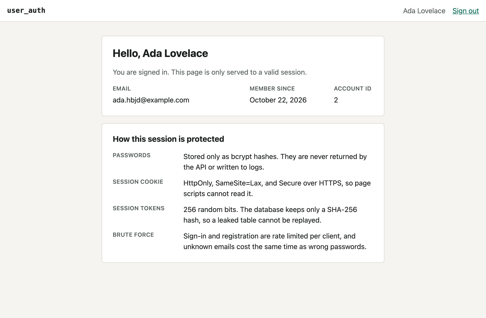
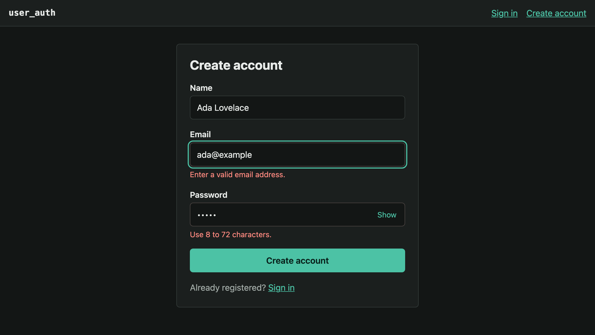
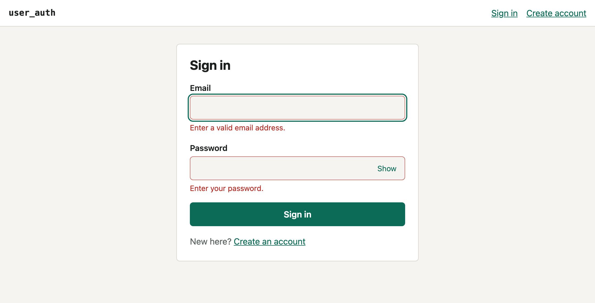

# user_auth

A small, production-minded account service: register, sign in, stay signed in, sign out. A Go JSON API backed by
PostgreSQL, with a React + TypeScript frontend that ships inside the same single binary.



| Registration, dark mode                         | Sign-in validation, light mode             |
|:-----------------------------------------------:|:------------------------------------------:|
|  |  |

## What it demonstrates

- **Session auth done carefully.** Opaque 256-bit session tokens in an `HttpOnly`, `SameSite=Lax` cookie (`__Host-`
  prefixed and `Secure` over HTTPS). Only a SHA-256 hash of the token is stored, so a leaked table cannot be replayed.
- **Passwords.** bcrypt, a 72-byte limit enforced instead of silently truncated, and a dummy hash compared for unknown
  emails so response time does not reveal who is registered.
- **Layered defences.** Per-client rate limiting on sign-in and registration, an `Origin` check against cross-site
  forgery, strict security headers (CSP, `nosniff`, HSTS), a request body size cap, and generic error messages.
- **Idiomatic Go.** One module, `internal/` packages, interfaces defined by their consumers, `context` on every
  database call, `log/slog` structured logs, and graceful shutdown on SIGINT and SIGTERM.
- **Accessible frontend.** Labelled fields wired with `aria-describedby`, focus moved to the first invalid field,
  keyboard-only flow, light and dark themes, and an axe-core audit in the browser tests.
- **Three test layers.** Go unit and Postgres integration tests, Vitest component tests, and Playwright browser tests
  against the real server.

## Quick start

You need Go 1.26+, Node 24+ and Docker.

```bash
make setup    # install frontend dependencies and start Postgres in Docker
make run      # build the frontend and start the server on http://localhost:8080
```

Or run everything in containers (a 21 MB distroless image):

```bash
make docker-up     # app on http://localhost:8080 plus Postgres
make docker-down
```

For frontend work, run the API with `make run-api` and, in another terminal, `cd web && npm run dev`. Vite serves the UI
on port 5173 and proxies `/api` to the Go server, so the browser only ever talks to one origin.

## Commands

| Command            | What it does                                                            |
|--------------------|-------------------------------------------------------------------------|
| `make setup`       | Install frontend dependencies and start Postgres                        |
| `make run`         | Build the frontend, then run the single-binary server                   |
| `make run-api`     | Run only the Go API on port 8080                                        |
| `make test`        | Go tests with the race detector, including Postgres integration tests   |
| `make test-web`    | Vitest component and unit tests                                         |
| `make test-e2e`    | Playwright browser tests against the real server on port 8081           |
| `make lint`        | `go vet`, `golangci-lint`, ESLint, Prettier and the TypeScript compiler |
| `make build`       | Build `bin/server` with the frontend embedded                           |
| `make screenshots` | Regenerate the images in `docs/screenshots` from a running server       |

## API

All bodies are JSON. Errors use `{"error": {"code", "message", "fields"}}`.

| Method | Path                    | Auth   | Success | Failure                                               |
|--------|-------------------------|--------|---------|-------------------------------------------------------|
| POST   | `/api/v1/auth/register` | none   | 201     | 422 invalid fields, 409 email taken, 429 rate limited |
| POST   | `/api/v1/auth/login`    | none   | 200     | 401 invalid credentials, 429 rate limited             |
| POST   | `/api/v1/auth/logout`   | cookie | 204     | none (always clears the cookie)                       |
| GET    | `/api/v1/me`            | cookie | 200     | 401 not signed in                                     |
| GET    | `/healthz`              | none   | 200     | none                                                  |
| GET    | `/readyz`               | none   | 200     | 503 database unreachable                              |

Try it:

```bash
curl -i -c jar -X POST localhost:8080/api/v1/auth/register -H 'Content-Type: application/json' \
  -d '{"email":"ada@example.com","name":"Ada","password":"correct horse battery"}'
curl -i -c jar -X POST localhost:8080/api/v1/auth/login -H 'Content-Type: application/json' \
  -d '{"email":"ada@example.com","password":"correct horse battery"}'
curl -b jar localhost:8080/api/v1/me
```

## Configuration

Settings come from environment variables; see `.env.example`.

| Variable                | Default | Meaning                                                                     |
|-------------------------|---------|-----------------------------------------------------------------------------|
| `AUTH_DATABASE_URL`     | none    | PostgreSQL connection string (required)                                     |
| `AUTH_ADDR`             | `:8080` | Listen address                                                              |
| `AUTH_COOKIE_SECURE`    | `true`  | Mark the session cookie `Secure`; set `false` only for plain-http local use |
| `AUTH_BCRYPT_COST`      | `12`    | bcrypt cost, 10 to 14                                                       |
| `AUTH_SESSION_TTL`      | `24h`   | Session lifetime                                                            |
| `AUTH_RATE_LIMIT_BURST` | `10`    | Sign-in and registration attempts per client before throttling              |

Migrations run automatically at startup.

## Layout

```text
cmd/server/            entry point: config, wiring, graceful shutdown
internal/auth/         use cases and rules; knows nothing about HTTP or SQL
internal/store/        PostgreSQL implementation and embedded migrations
internal/httpapi/      handlers, middleware, rate limiter, SPA serving
internal/config/       environment parsing
web/                   React + TypeScript frontend (Vite), Vitest and Playwright tests
```

Why things are the way they are is recorded in [docs/DECISIONS.md](docs/DECISIONS.md).

## Known limits

- The rate limiter keys on the TCP peer address and lives in memory. Behind a reverse proxy, limit at the proxy, or
  all users share one bucket. With several instances, each keeps its own counters.
- Registration reveals whether an email is taken (409). That is a deliberate usability trade-off; the sign-in path does
  not reveal it.
- There is no email verification, password reset or multi-factor authentication.
